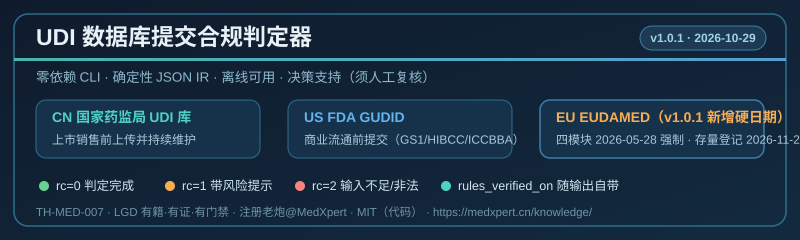

# udi-db-submission-check · UDI 数据库提交合规判定器

[](https://github.com/zhaoxinghua09-cell/lgd-theory)



> Zero-dependency deterministic CLI screener for medical-device compliance.
> **Decision support only — NOT legal/regulatory advice. Always verify against official texts.** Text verified: 2026-10-29 (EU hard dates re-checked against Commission Decision (EU) 2025/2371 and the EC EUDAMED transitional timetable).

## Why

UDI 码串格式对了，但该传哪个库、什么时候传、必填哪些字段，没人一次说清；漏传或漏维护，上市即违规。

## What it does

Screens `udi-db-submission-check` against public rule sources: **NMPA《医疗器械唯一标识系统规则》/ FDA 21 CFR 830 + GUDID / EU MDR Art 27-29 + EUDAMED**.
Outputs deterministic JSON IR with `rc` (0 = ok / 1 = ok with warnings / 2 = insufficient input),
`error_code`, and GB 45438-2025 AIGC metadata. No network, no API key, no third-party packages.

- **Insufficient input → strict presumption**: missing DI/PI and an unconfirmed CN registration status are flagged in `warnings` (`rc=1`) — never silently treated as "submittable".
- `--sterile yes` adds the sterile-indicator field to `core_fields` (must match the label).
- **EU hard dates** (verified 2026-10-29): the first four EUDAMED modules (Actor, UDI/Dev, NB&CRF, MS) have been mandatory since **2026-05-28**; legacy/Regulation devices placed on the market before that date must be registered in the UDI/Dev module by **2026-11-28** (EC EUDAMED transitional timetable; per Commission Decision (EU) 2025/2371, OJEU 2025-11-27). MDR-native devices still follow the regular Art 29 timing.
- Every JSON output carries `rules_verified_on` (same level as `rc`), sourced from the single constant `RULES_VERIFIED_ON` in the script — same value as the "Text verified" line above.
- Measured: full CN args → rc=0; `--market us --has_di yes --reusable yes` → rc=1 (PI missing); `--market jp` → rc=2.

## Run it (Python 3.8+)

```bash
python udi-db-submission-check.py --demo
python udi-db-submission-check.py --json <your args...>
```

## Compliance & IP

- Author: 注册老炮@MedXpert · © 2026 MedXpert · MIT License
- Theory anchor: `TH-MED-007` (LGD · registry / evidence / gate)
- Published by an AI-assisted studio; the institution bears responsibility for the output.
- Online (Chinese): https://medxpert.cn/knowledge/

---

## License & attribution
**分层许可（务必并读；代码许可不覆盖文档与理论文本）**

| 层 | 载体 | 许可 |
|---|---|---|
| 代码 | `udi-db-submission-check.py` | **MIT** |
| 文档与理论文本 | 本 `SKILL.md`、`README.md`、其中「理论依据」段与一切理论表述 | **不在代码许可覆盖范围内**：保留所有权利（All rights reserved） |

> 即：**代码可依其自身许可使用与再分发；文档与理论文本不因代码许可而默认可自由再发布。**

```
© 2026 赵兴华 / Steven Zhao·China (ORCID 0009-0001-0512-1237). All rights reserved.
理论署名 (attribution) : LGD（Lifecycle Governance Doctrine / 全程治理论）— SynomosAI initiative
名称状态 (name status)  : "SynomosAI" / "MedXpert" — 未申请实体注册、未申请商标注册
                        (not a registered legal entity; no trademark registered)
生产参考部署 (production reference, self-reported) : MedXpert
                    ← 非认证、非背书、非监管认可（not a certification or endorsement）
代码许可 (code license) : 本包 = MIT (see LICENSE)
                    本文本与理论表述不在任何代码许可覆盖范围内
引用格式 (cite as)      : 本资产无 DOI
```
（上列为《LGD 对外表述规范》§3.2 统一块：**A 段公共段逐字复制、未删改；B 段资产参数段按本包真值填写**；发布 / 重提前须照最新版本复核。）

## Family

| 环节 | 工具 | 位置 |
|---|---|---|
| 分类与路径 | `md-classification-route` | 本批 |
| 注册资料-技术文件 | `medxpert-reg-hub` | 存量枢纽 |
| 临床评价（选路） | `clin-eval-route-picker` | 存量 |
| 临床评价（证据要素） | `cer-equivalence-check` | 本批 |
| 检测项目与实验室匹配 | `test-lab-match-check` | 本批 |
| 申报前非临床研究 | `non-clinical-checker` | 存量 |
| UDI（格式校验） | `udi-format-validator` | 存量 |
| UDI（数据库提交） | `udi-db-submission-check` | 本批 |
| 上市后·PMCF 计划 | `pmcf-plan-check` | 存量 |
| 上市后·PMCF 评价报告 | `pmcf-evaluation-report-check` | 本批 |
| 上市后·不良事件 | `pms-vigilance-intake` | 存量 |
| 上市后·召回 | `recall-decision-checker` | 存量 |
| 标签与说明书 | `label-compliance-checker` | 存量 |
| 进出口路径 | `import-export-router` | 存量 |

---
## About LGD Governance

This skill package is part of the **agent-skills** library by **SynomosAI** under the **LGD — Lifecycle Governance Doctrine (全程治理论)** research line, a civil-society governance-engineering framework for AI systems (an independent research initiative, not a registered company, standard, or provider of legal, regulatory, or medical advice).

Its core proposition is the **Three Laws of self-governing things**: **registered (有籍) · evidenced (有证) · gated (有门禁)** — every self-governing thing must hold a verifiable identity, produce auditable evidence across its full lifecycle, and pass explicit gates before consequential actions.

Byline: **XLGD · SynomosAI** (the formal identifier is LGD). Skill index: https://zhaoxinghua09-cell.github.io/lgd-skills-index/ · Theory stack: https://github.com/zhaoxinghua09-cell/lgd-theory

## 关于 LGD 治理体系

本技能包隶属于 **SynomosAI** 出品的 **agent-skills** 技能库，归属 **LGD（Lifecycle Governance Doctrine，全程治理论）** 研究线——面向 AI 系统的民间治理工程研究框架（独立研究倡议，非注册公司、非标准，亦非法律、监管或医疗建议提供方）。

其核心命题是「自洽事物的三律」：**有籍 · 有证 · 有门禁**（registered · evidenced · gated）——每一自洽事物必须持有可核验的身份、在全生命周期内产出可审计的证据，并在高影响动作前通过明确门禁。

作者署名口径：**XLGD · SynomosAI**（正式标识为 LGD）。技能索引：https://zhaoxinghua09-cell.github.io/lgd-skills-index/ · 理论栈：https://github.com/zhaoxinghua09-cell/lgd-theory
